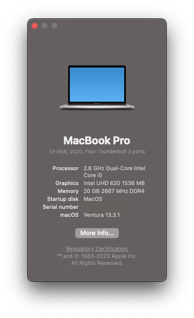
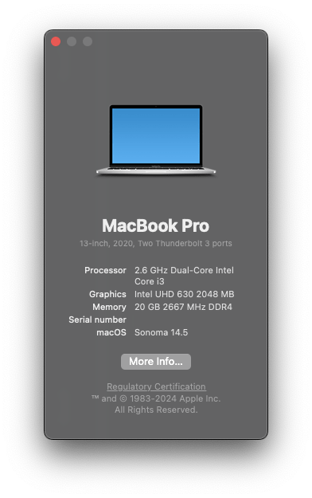
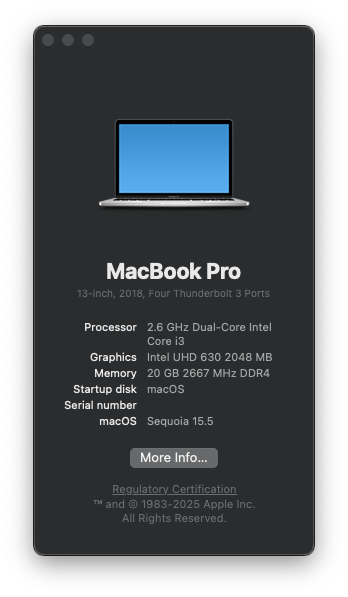
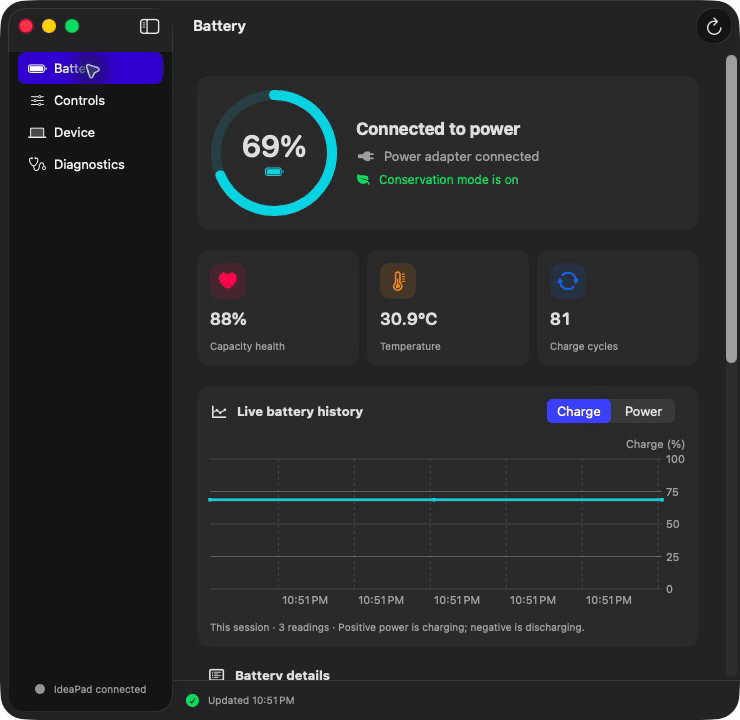
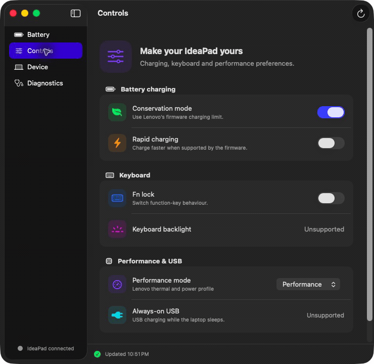
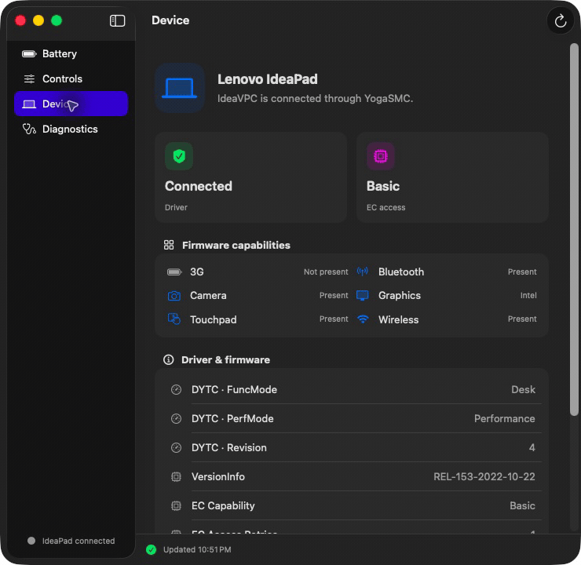
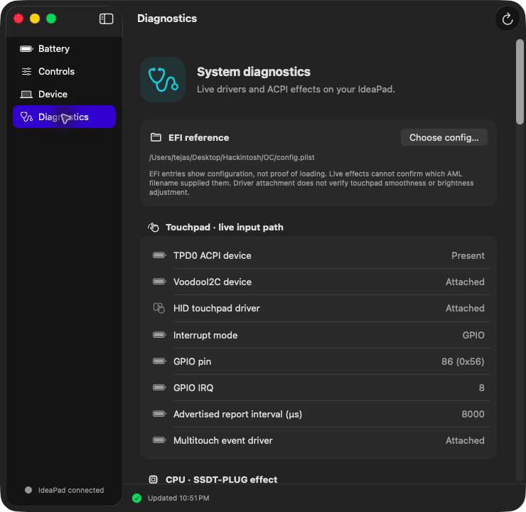

<!-- ALL-CONTRIBUTORS-BADGE:START - Do not remove or modify this section -->

<!-- ALL-CONTRIBUTORS-BADGE:END -->

# Lenovo-Ideapad-3-15IML05-Hackintosh

Goal of this repo is to run macOS on Lenovo IdeaPad 3 15IML05 Laptop.

|          macOS Ventura 13.3.1           |           macOS Sonoma 14.5           |          macOS Sequoia 15.5           |           macOS Tahoe 26.7.3            |
| :-------------------------------------: | :-----------------------------------: | :-----------------------------------: | :-------------------------------------: |
|  |  |  |  |

## IdeaPad VPC tool

[IdeaVPC](Tools/IdeaVPC/README.md) is a native SwiftUI companion for the Lenovo IdeaPad `IdeaVPC` service provided by [YogaSMC](https://github.com/zhen-zen/YogaSMC). It shows battery health and live history, charging/Fn lock/performance controls, firmware capabilities, and read-only driver/ACPI diagnostics.

| Battery | Controls | Device | Diagnostics |
| :---: | :---: | :---: | :---: |
|  |  |  |  |

Fresh screenshots captured on macOS Tahoe 26.7.3 on November 13, 2026. Download **IdeaVPC_1.0_build3.zip** and the sanitized **OpenCore 1.0.8 EFI** from [Releases](https://github.com/gajjartejas/Lenovo-Ideapad-3-15IML05-Hackintosh/releases/latest). IdeaVPC requires macOS 26 and a working YogaSMC driver; the app does not install kexts or change EFI. The app is ad-hoc signed and is not notarized. Hardware-changing controls and administrator elevation have not been tested; diagnostics and screenshot capture used read-only operations.

## OpenCore Installation Guide

Go to [INSTALLATION_GUIDE_OPENCORE.md](INSTALLATION_GUIDE_OPENCORE.md)(**Detailed guide**)

## Wi-Fi Note

Native Wi-Fi works out-of-the-box via [`AirportItlwm.kext`](https://github.com/laobamac/itlwm/releases) (maintained by [laobamac](https://github.com/laobamac/itlwm) with builds for macOS 14 Sonoma, macOS 15 Sequoia, and macOS 26 Tahoe) with full native macOS Control Center integration. HeliPort is not required.

## About this Laptop

### Original Hardware Info 💻

| Type         | Spec                                                            | Status  | Driver / Kext Link                                                                                                                                                 |
| :----------- | :-------------------------------------------------------------- | :------ | :----------------------------------------------------------------------------------------------------------------------------------------------------------------- |
| Computer     | Lenovo IdeaPad 3 15IML05 U1                                     | Working | -                                                                                                                                                                  |
| BIOS Version | LENOVO DXCN39WW (10/13/2021)                                    | Working | -                                                                                                                                                                  |
| CPU          | DualCore Intel Core i3-10110U, 3700 MHz (37 x 100)              | Working | Native Power Management via [SSDT-PLUG](https://dortania.github.io/Getting-Started-With-ACPI/Universal/plug.html)                                                 |
| Chipset      | Intel Comet Point-LP, Intel Comet Lake-U                        | Working | -                                                                                                                                                                  |
| Graphics     | Intel(R) UHD Graphics                                           | Working | [WhateverGreen.kext](https://github.com/acidanthera/WhateverGreen)                                                                                                 |
| Audio        | Realtek ALC 230, Codec ID:10EC0230 / 17AA383A                   | Working | [SimpleHDA.kext](https://github.com/laobamac/SimpleHDA)                                                                                                            |
| Ethernet     | Not Present                                                     | N/A     | -                                                                                                                                                                  |
| WiFi         | Intel(R) Wireless-AC 9560                                       | Working | [AirportItlwm.kext](https://github.com/laobamac/itlwm/releases)                                                                                                     |
| Bluetooth    | Intel(R) Wireless Bluetooth(R) - USB\VID_8087&PID_0AAA&REV_0002 | Working | [IntelBluetoothFirmware.kext](https://github.com/lshbluesky/IntelBluetoothFirmware) + [BlueToolFixup.kext](https://github.com/acidanthera/BrcmPatchRAM)          |
| Touchpad     | I2C ELAN0001 [PnP - MSFT0001]                                   | Working | [VoodooI2C.kext](https://github.com/VoodooI2C/VoodooI2C) + [VoodooI2CHID.kext](https://github.com/VoodooI2C/VoodooI2C)                                           |
| Keyboard     | Standard PS/2 Keyboard                                          | Working | [VoodooPS2Controller.kext](https://github.com/acidanthera/VoodooPS2)                                                                                               |
| Webcam       | Integrated Camera - USB\VID_30C9&PID_001B&REV_0005&MI_00        | Working | Native (USB UVC)                                                                                                                                                   |
| Battery      | Sunwoda - L19D3PF5 - Rechargeable LiP - 46270 mWh               | Working | [SMCBatteryManager.kext](https://github.com/acidanthera/VirtualSMC) + [YogaSMC.kext](https://github.com/zhen-zen/YogaSMC)                                         |

### Modifications/Accessories 🔨

| Type                                                                                 | Spec | Status  |
| :----------------------------------------------------------------------------------- | :--- | :------ |
| Wireless Bluetooth Mouse Rechargeable Mouse                                          | -    | Working |
| G.Skill Ripjaws SO-DIMM 16GB (1 \* 16GB) DDR4 3200 CL22-22-22-52 1.20V Laptop Memory | -    | Working |

### Software Status 👨‍💻

| Type                            | Spec | Status                                                                                                                     |
| :------------------------------ | :--- | :------------------------------------------------------------------------------------------------------------------------- |
| Battery Status                  | -    | Working                                                                                                                    |
| Brightness With keys(F11 - F12) | -    | Working                                                                                                                    |
| Sleep                           | -    | Not Working                                                                                                                |
| Trackpad                        | -    | Laggy and High CPU usages when charging (Hardware grounding issue across Windows, Linux & macOS; works normally on battery) |

> [!NOTE]
> **Trackpad Lag**: The trackpad lag and elevated CPU usage (10% to 15%) occurs specifically when the laptop is connected to the charger. This is a known hardware electrical/grounding issue on this model present across Windows, Linux, and macOS. When running on battery power alone, the trackpad operates normally.

### Kexts Used (Grouped by Hardware Feature)

Enabled/Disabled values below reflect the mounted EFI packaged for v4.1.1; runtime attachment is reported separately by IdeaVPC diagnostics.

| Hardware Feature | Kext | Status | Info / Purpose |
| :--- | :--- | :---: | :--- |
| **System & Core** | [Lilu.kext](https://github.com/acidanthera/Lilu) | Enabled | Arbitrary kext and process patching engine for macOS. |
| | [VirtualSMC.kext](https://github.com/acidanthera/VirtualSMC) | Enabled | SMC Emulator Layer; essential for macOS boot. |
| | [CpuTscSync.kext](https://github.com/acidanthera/CpuTscSync) | Enabled | Syncs TSC across CPU cores for reliable timing. |
| | [HibernationFixup.kext](https://github.com/acidanthera/HibernationFixup) | Enabled | Resolves hibernation and RTC sleep sync issues. |
| | [RestrictEvents.kext](https://github.com/acidanthera/RestrictEvents) | Enabled | Blocks unwanted background daemons and unlocks hardware features. |
| | [FeatureUnlock.kext](https://github.com/acidanthera/FeatureUnlock) | Enabled | Unlocks Sidecar, AirPlay, and night shift support. |
| | [ECEnabler.kext](https://github.com/1Revenger1/ECEnabler) | Disabled | Disabled; Embedded Controller handled natively via `SSDT-EC.aml`. |
| | [HWPEnabler.kext](https://github.com/PMheart/HWPEnable) | Disabled | Optional hardware P-state helper; disabled in the release EFI. |
| | [RTCMemoryFixup.kext](https://github.com/acidanthera/RTCMemoryFixup) | Disabled | Optional RTC memory patcher; disabled in the release EFI. |
| **Graphics & Backlight** | [WhateverGreen.kext](https://github.com/acidanthera/WhateverGreen) | Enabled | Framebuffer and display patches for Intel UHD Graphics 630. |
| | [BrightnessKeys.kext](https://github.com/acidanthera/BrightnessKeys) | Enabled | Handler for display brightness function keys (F11/F12) without DSDT patches. |
| **Audio** | [SimpleHDA.kext](https://github.com/laobamac/SimpleHDA) | Enabled | Native lightweight AppleHDA audio driver for Realtek ALC230 codec. |
| | [AppleALC.kext](https://github.com/acidanthera/AppleALC) | Enabled | Alternative / supplementary audio patcher for AppleHDA. |
| **Wi-Fi & Bluetooth** | [AirportItlwm.kext](https://github.com/laobamac/itlwm/releases) | Enabled | Intel Wireless-AC 9560 native Wi-Fi driver with macOS Control Center integration (via [laobamac/itlwm](https://github.com/laobamac/itlwm)). |
| | [itlwm.kext](https://github.com/OpenIntelWireless/itlwm) | Disabled | Disabled; replaced by native `AirportItlwm.kext` (no HeliPort needed). |
| | [IntelBluetoothFirmware.kext](https://github.com/lshbluesky/IntelBluetoothFirmware) | Enabled | Intel Bluetooth firmware uploader for Intel AC 9560. |
| | [IntelBTPatcher.kext](https://github.com/lshbluesky/IntelBluetoothFirmware) | Enabled | Fixes Intel Bluetooth driver bugs and patches functionality on macOS. |
| | [BlueToolFixup.kext](https://github.com/acidanthera/BrcmPatchRAM) | Enabled | Required for macOS 12 Monterey through macOS 26 Tahoe Bluetooth stack. |
| | [BrcmPatchRAM3.kext](https://github.com/acidanthera/BrcmPatchRAM) | Disabled | Disabled; Intel Bluetooth card present. |
| | [BrcmFirmwareData.kext](https://github.com/acidanthera/BrcmPatchRAM) | Disabled | Disabled; Intel Bluetooth card present. |
| | [IntelBluetoothInjector.kext](https://github.com/lshbluesky/IntelBluetoothFirmware) | Disabled | Legacy codeless Bluetooth injector; disabled on Tahoe. |
| **Input (Trackpad & Keyboard)** | [VoodooI2C.kext](https://github.com/VoodooI2C/VoodooI2C) | Enabled | Core I2C bus controller driver for ELAN0001 I2C touchpad. |
| | [VoodooI2CHID.kext](https://github.com/VoodooI2C/VoodooI2C) | Enabled | I2C HID satellite driver for multi-touch gestures. |
| | [VoodooPS2Controller.kext](https://github.com/acidanthera/VoodooPS2) | Enabled | PS/2 keyboard controller driver. |
| **Sensors & Power** | [SMCProcessor.kext](https://github.com/acidanthera/VirtualSMC) | Enabled | Processor Temperature Monitoring. |
| | [SMCSuperIO.kext](https://github.com/acidanthera/VirtualSMC) | Enabled | Motherboard hardware sensor and fan speed readouts. |
| | [SMCBatteryManager.kext](https://github.com/acidanthera/VirtualSMC) | Enabled | Battery status and charge cycle monitoring. |
| | [YogaSMC.kext](https://github.com/zhen-zen/YogaSMC) | Enabled | Provides the IdeaVPC service used by the IdeaVPC companion app. |
| **USB & Storage** | [NVMeFix.kext](https://github.com/acidanthera/NVMeFix) | Enabled | Power management and APST state optimization for non-Apple NVMe SSDs. |
| | [HoRNDIS.kext](https://github.com/jwise/HoRNDIS) | Enabled | USB tethering support for Android devices. |
| | [USBMap.kext](https://github.com/corpnewt/USBMap) | Disabled | Disabled; native macOS XHCI handles ports (under 15-port limit) without D3 crashes. |

### SSDTs Used (Grouped by Hardware Feature)

| Hardware Feature | SSDT | Status | Info / Purpose | Reference Link |
| :--- | :--- | :---: | :--- | :--- |
| **System & Core** | `SSDT-AWAC.aml` | Enabled | Sets `STAS = 1` to resolve AWAC / RTC clock lockup on Comet Lake | [Dortania AWAC Guide](https://dortania.github.io/Getting-Started-With-ACPI/Universal/awac.html) |
| | `SSDT-EC.aml` | Enabled | Injects fake Embedded Controller device (`ACID0001`) with Darwin conditional | [Dortania EC Guide](https://dortania.github.io/Getting-Started-With-ACPI/Universal/ec-fix.html) |
| | `SSDT-GPRW.aml` | Enabled | Resolves instant wake from sleep caused by USB/LAN assertion | [Dortania Sleep Guide](https://dortania.github.io/Getting-Started-With-ACPI/Universal/sleep.html) |
| | `SSDT-ECRW.aml` | Disabled | Disabled; optional helper table; not required by the current IdeaVPC service | [YogaSMC](https://github.com/zhen-zen/YogaSMC) |
| | `SSDT-YVPC.aml` | Disabled | Disabled; optional Lenovo VPC helper; current IdeaVPC service attaches without it | [YogaSMC](https://github.com/zhen-zen/YogaSMC) |
| | `SSDT-RCSM.aml` | Disabled | Disabled; redundant helper table not required on Comet Lake | - |
| **CPU Power Management** | `SSDT-PLUG.aml` | Enabled | Injects `plugin-type=1` under `PR00` for native CPU Power Management (XCPM) | [Dortania Power Guide](https://dortania.github.io/Getting-Started-With-ACPI/Universal/plug.html) |
| **Graphics & Backlight** | `SSDT-PNLF.aml` | Enabled | Defines clean `PNLF` device (`_UID = 0x13`) under `PCI0.GFX0` for display backlight | [Dortania Backlight Guide](https://dortania.github.io/Getting-Started-With-ACPI/Laptops/backlight.html) |
| | `SSDT-ALS0.aml` | Enabled | Ambient Light Sensor (`ACPI0008`) stub to preserve display brightness across reboots | [OpenCorePkg ALS0](https://github.com/Acidanthera/OpenCorePkg/blob/master/Docs/AcpiSamples/Source/SSDT-ALS0.dsl) |
| | `SSDT-MEM2.aml` | Disabled | Disabled in the current release EFI; legacy IGPU memory-map helper | [Dortania IGPU Guide](https://dortania.github.io/Getting-Started-With-ACPI/) |
| **Input (Trackpad)** | `SSDT-TPD0.aml` | Enabled | Injects fixed I2C trackpad device with 4-arg `_DSM` fallback to prevent panics | [VoodooI2C Guide](https://voodooi2c.github.io/) |
| | `SSDT-HPET.aml` | Enabled | Fixes IRQ routing conflicts (IRQ 0, 8) for system timer and RTC | [Dortania HPET Guide](https://dortania.github.io/Getting-Started-With-ACPI/Universal/irq.html) |
| | `SSDT-XOSI.aml` | Enabled | Windows OSI emulation to route I2C trackpad interrupts properly | [Dortania Trackpad Guide](https://dortania.github.io/Getting-Started-With-ACPI/Laptops/trackpad.html) |
| **USB & Motherboard** | `SSDT-USBX.aml` | Enabled | Injects generic USB power supply properties (`kUSBSleepPortCurrentLimit`, etc.) | [Dortania USBX Guide](https://dortania.github.io/Getting-Started-With-ACPI/Universal/ec-fix.html#fixing-embedded-controller-ssdt-ecusbx) |
| | `SSDT-SBUS.aml` | Enabled | Adds `BUS0` under `PCI0.SBUS` for system management bus functionality | [Dortania SMBus Guide](https://dortania.github.io/Getting-Started-With-ACPI/Universal/smbus.html) |
| | `SSDT-RHUB.aml` | Disabled | Disabled; disabling RHUB broke internal Bluetooth (HS10) radio descriptors | - |

### TODO

- Sleep issue
- Trackpad lag and elevated CPU usage when connected to charger (hardware electrical/grounding issue).
- Suggest to me via issue.

### Telegram Channel

- [India Hackintosh Community Group](https://t.me/indianhackintosh)
- [India Hackintosh Channel](https://t.me/hackintoshcommunity)

### Credits

- [Apple](https://www.apple.com) for macOS.
- [Acidanthera](https://github.com/acidanthera) for OpenCorePkg, Lilu, VirtualSMC, WhateverGreen, BrightnessKeys, RestrictEvents, NVMeFix, BrcmPatchRAM, and VoodooPS2.
- [laobamac](https://github.com/laobamac) for SimpleHDA and AirportItlwm / itlwm.
- [lshbluesky](https://github.com/lshbluesky) for IntelBluetoothFirmware and IntelBTPatcher.
- [OpenIntelWireless](https://github.com/OpenIntelWireless) for Intel Wi-Fi & Bluetooth drivers and HeliPort.
- [VoodooI2C](https://github.com/VoodooI2C/VoodooI2C) for I2C Touchpad driver and gesture support.
- [USBToolBox](https://github.com/USBToolBox) for USB mapping utilities and companion kext.
- [zhen-zen](https://github.com/zhen-zen) for YogaSMC.
- [Dortania](https://dortania.github.io/) for comprehensive OpenCore installation and post-install guides.
- [corpnewt](https://github.com/corpnewt) for GenSMBIOS, ProperTree, and SSDTTime.
- [RehabMan](https://github.com/RehabMan) for essential ACPI patches and guides.
- [daliansky](https://github.com/daliansky) for ACPI hotpatch samples and Dortania contributions.
- [Steve Zheng](https://github.com/stevezhengshiqi) for ACPI patches.
- [Sniki](https://github.com/Sniki) for ACPI patching guides.
- [Moh_Ameen](https://github.com/ameenjuz) for initial IdeaPad patches.
- And everyone in the hackintosh community who contributed to open-source drivers and tools.
